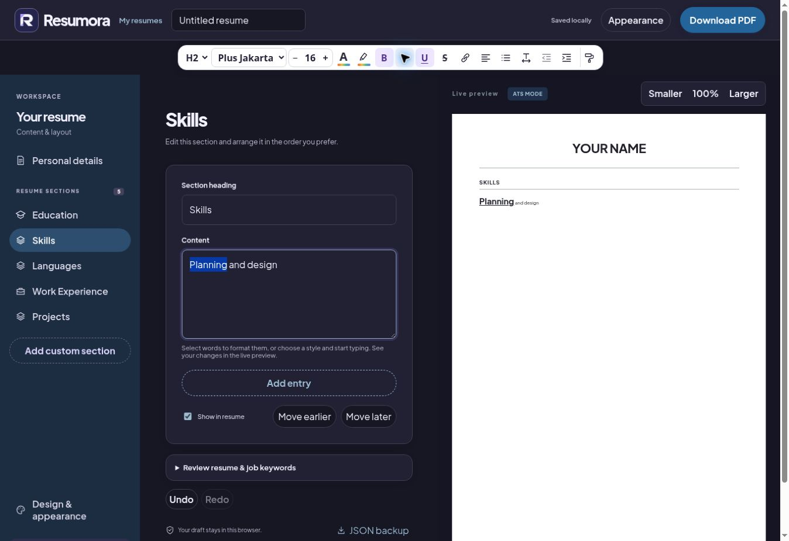

<p align="center">
  
</p>

<h1 align="center">Resumora</h1>

<p align="center">
  A browser-based CV builder for students, graduates, and job seekers.
</p>

<p align="center">
  <strong>Version 1.0</strong> · React · TypeScript · Vite
</p>

<p align="center">
  <a href="#quick-start">Quick start</a> ·
  <a href="#features">Features</a> ·
  <a href="#development">Development</a>
</p>



## Quick start

1. On GitHub, select **Code**, then **Download ZIP**. Extract the ZIP on your computer.
2. Open **Resumora.html** in Chrome or Edge. This standalone file runs without installing Node.js.
3. Select **Create my resume** to start from scratch or **Try a sample** to explore the editor.
4. Add your details, choose a layout, and select **Download PDF** when your CV is ready. Save a **JSON backup** if you want to edit it on another device.

## Features

| Feature | What you can do |
| --- | --- |
| CV editor | Add, reorder, and hide sections. Format text, insert links, and edit directly on the CV. |
| Templates and styles | Pick from five templates. Use **Strict ATS** for a simple layout or **Creative** for more control over colours and photos. |
| Live preview and PDF | See changes as you edit. Check page breaks and download a PDF in A4 or Letter size. |
| My resumes | Find, rename, and duplicate saved drafts. Create a separate version for each job application. |
| CV Assistant | Review possible writing mistakes, compare your CV with a job description, and check which requirements your CV covers. |

**ATS** stands for *Applicant Tracking System*. The job review highlights requirements covered by the visible CV. Use it to decide what details to add before applying. Optional AI rewriting depends on browser support.

## Drafts and backups

Resumora stores drafts in the browser on your device. Export a JSON backup before clearing browser data or moving to another device, then import it through **My resumes**. Backups can include contact details you’ve hidden from the PDF, so keep them somewhere private.

## Development

Use **Node.js 22.12 or newer**. Open the folder containing `package.json` in VS Code and run these commands in the terminal.

```bash
npm ci
npm run dev
```

Open the local address printed by Vite.

| Command | What it does |
| --- | --- |
| `npm test` | Runs the automated tests for formatting, backups, writing checks, and PDF output. |
| `npm run build` | Checks TypeScript, builds the site into `dist/`, and regenerates `Resumora.html`. |
| `npm run preview` | Opens a local preview of the production build. |

To host the site, upload the contents of `dist/` to a static web host. React and TypeScript power the editor, IndexedDB stores drafts, and pdfmake generates the PDFs in the browser.

## Author

Built by **Gaweesha Bhagyajith Kumarathunga**. [LinkedIn](https://www.linkedin.com/in/r-p-g-b-kumarathunga-0a8568351/)

See [THIRD_PARTY.txt](THIRD_PARTY.txt) for library and font notices.
