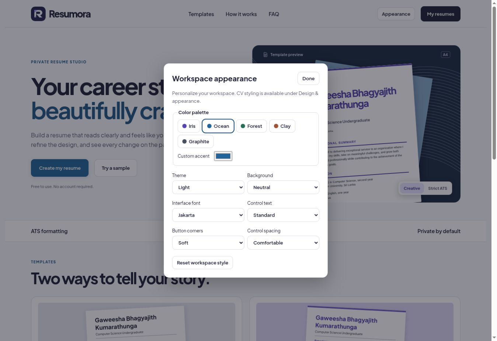

# Resumora 1.0

Your career story, beautifully crafted.

Resumora is a private, frontend-only resume studio for students, graduates, and professionals. It includes a landing page, a local document dashboard, an editor, and a live paper preview.



## Try it on Windows

Extract the ZIP. Open **Resumora.html** in Chrome or Edge and choose **Try a sample**. The HTML contains the compiled app, styles, and logo. No installation is required for this edition. Keep a JSON backup when moving the file or changing browsers.

For development, place the extracted project at D:\Projects\resumora and use Node.js 22.12 or later. Run these commands in PowerShell.

```powershell
Set-Location 'D:\Projects\resumora'
npm ci
npm run dev
```

Open the local address printed by Vite. Use the same address and port each time to access the same drafts.

## Using the studio

- Create a blank resume or start with the Gaweesha’s CV sample.
- Edit the profile and summary. Use the section content box for free-form text or Add entry for structured experience, education, project, and skill records. Each achievement line becomes a bullet.
- Copy, reorder, or remove entries. Drag desktop section buttons or use the Move up and Move down buttons. Custom sections accept a heading, free-form content, and structured entries.
- Use Design & appearance to select ATS or Creative mode, font, section spacing, paper size, and creative accent. On mobile and tablet, use Edit and Preview to switch views.
- Use Undo and Redo for the last 100 edits in the open editor. Ctrl/Cmd+Z undoes an edit and Ctrl/Cmd+Shift+Z redoes it.
- Open Review resume & job keywords for transparent content checks and exact word matching. The job description stays in editor memory.
- Use Download PDF to generate a selectable-text PDF directly on your device.
- In My resumes, search, rename, duplicate, delete with confirmation, or import a backup. JSON import creates a new document. Backups include your contact information.


## Storage and privacy

Drafts use IndexedDB. The interface theme uses localStorage. A valid starter draft under the original localStorage key migrates on the same browser origin. Clearing site data, switching profiles, changing the app address, or private browsing can remove access to drafts. Export backups regularly. Storage failures show an in-app warning. Keep one editor tab open per draft to avoid simultaneous edits overwriting one another. The app makes no requests for fonts, resume analysis, or resume storage.

## Engineering

React 19, TypeScript, Vite, browser-native IndexedDB, CSS, and local SVG icons. All routes use URL fragments so static hosting can serve the app without server rewrites.

| File | Responsibility |
| --- | --- |
| src/App.tsx | Routes, themes, draft lifecycle and save feedback |
| src/Landing.tsx and src/Dashboard.tsx | Public home and document management |
| src/Editor.tsx and src/Entries.tsx | Editing, section ordering, history, and entry forms |
| src/Paper.tsx | Shared resume rendering for previews and printing |
| src/model.ts and src/storage.ts | Typed documents, validated imports, persistence and starter migration |
| src/analysis.ts and src/Checker.tsx | Local content checks and job term comparison |
| scripts/portable.mjs | Build the self-contained HTML from Vite output |

## Testing and production build

```powershell
npm test
npm run build
npx playwright install chromium
npm run test:e2e
```

The build writes static assets into dist and regenerates Resumora.html. Run npm run preview to serve the production build locally. For a future Vercel deployment, select Vite, use npm run build, and choose dist as the output directory. Public deployment requires the owner's approval.

## Verification for version 0.2.0

- Strict TypeScript compilation, Vite production bundling, portable HTML generation, and four model/analysis tests passed.
- Verified in the managed Chromium browser: sample creation, blank creation, editing, repeatable entries and bullets, custom sections, ordering and visibility, undo/redo, ATS/Creative switches, paper size, font and color changes, live preview, persistence after reload, duplicate/search, JSON export and reimport, theme persistence, and job keyword feedback.
- Exercised the actual standalone build at 390px and 820px widths inside responsive test frames. Desktop and narrow-screen screenshots are included in docs.
- The Playwright suite is included. Both tests stopped at browser launch because the environment denied the local Chromium process a system socket. They did not reach their assertions. Native Chrome Save as PDF output, text extraction, long-document pagination, direct file launch with the network disabled, Safari, and Firefox still need release verification. The print media rules support flowing content and real text. On-screen previews currently grow continuously for long documents.

## Next milestones

1. Validate print output and page breaks for short and long A4 and Letter resumes, including long URLs and Unicode names. Add paginated on-screen navigation.
2. Expand the two initial visual modes into five templates, add reusable design presets, richer per-field controls, date validation, and contact visibility.
3. Complete accessibility, multi-browser, storage failure and concurrent editing tests before public release.

MIT is a suitable license to consider if you want others to reuse the project's source. The owner can select a license before publication. Third-party notices are in THIRD_PARTY.txt.

## Release notes

Version 0.2.0 restores the missing starter manifests, preserves the starter data model and free-form fields, and adds the landing page, dashboard, responsive editor, structured entries, browser storage, backups, themes, document styles, keyword review, and portable build.

### Version 0.3.0 — Visual redesign

The landing page, dashboard, and editor share a folded R monogram, ink-and-iris palette, and locally embedded Plus Jakarta Sans variable font. The landing page offers an interactive Creative and Strict ATS specimen. New resumes use Plus Jakarta Sans by default. Existing drafts keep their saved document typeface. The vector logo is included at src/assets/resumora-mark.svg.

The production build and four automated tests passed. Chromium review covered the desktop landing page, both preview modes, dark dashboard, sample editor, 390px phone preview, and 820px tablet dashboard.

### Version 0.4.0 — Reusable styles and contact visibility

Open Design & appearance to change body size, name size, or line spacing. Apply Classic ATS, Graduate Compact, or Editorial Serif, or save the current settings under a name. Personal presets persist in this browser and can be applied to other resumes. Presets contain presentation settings only. Each JSON resume backup includes its applied style.

Under Personal details, expand Professional links & contact visibility to enter LinkedIn, GitHub, and portfolio URLs. Toggle any contact field to hide it from the rendered resume while retaining its value in the editable draft and JSON backup.

The build and seven automated tests passed. Chromium checks verified a clickable GitHub link, hiding it, altering a preset, saving it, and reapplying it after reload.

## Version 0.5.0

The landing preview, template cards, and editable sample use Gaweesha Bhagyajith Kumarathunga’s CV. The bundled sample omits the phone number, personal email, and examination indices.

Appearance controls the workspace palette, custom accent, theme, font, background, control size, spacing and button shape. Design & appearance in the editor controls document margins, alignment, type sizes, spacing and, in Creative mode, the heading, text and divider colors. These settings are independent.

Download PDF writes the CV directly using embedded fonts and pdfmake. Browser print headers and footers do not enter this export. Plus Jakarta Sans is embedded for its Latin character set. Georgia uses Liberation Serif in the PDF. Arial and system sans use Liberation Sans. Native browser printing remains subject to browser print settings.

The downloaded sample was checked for selectable text, page dimensions and absence of browser time, path, title and pagination labels. No public deployment was performed.

## Version 0.6.0

Select words in your summary, section content, or entry details and choose Bold, Underline, or Clear formatting. Ctrl+B and Ctrl+U work on Windows, with Command shortcuts on macOS. The live preview, JSON backup and PDF retain the formatting. My resumes is available beside Create my resume on the home page. The preview zoom ranges from 50% to 150%. Click the percentage to fit the page again. Workspace animations respect your device’s reduced motion setting.

## Version 0.7.0

Click the CV name in the editor header to rename a draft. Press Enter or click away to save it. The same title is used for the PDF filename. Select words and choose Link or press Ctrl+K to attach a web address.

The text toolbar includes heading presets, fonts, size, text and highlight colors, bold, italic, underline, strikethrough, alignment, lists, letter and line spacing, indentation, and copy/apply style. Paragraph controls affect the current field. In PDFs, Jakarta italics use Liberation Sans Italic.

The personal sample, imported personal backups and existing personal sample drafts omit the old sample work experience. Other people’s entries and independently written experience are preserved.

## Version 0.7.1

Text fields share a floating formatting toolbar above the workspace. Select text in the summary, a section, or entry details to style it. Open Spacing for letter and line spacing, or Format painter to copy, apply, or clear a style. On narrow screens, swipe the toolbar sideways.

## Version 0.8.0

Start with a template on the home page or fill in the form first. Open **Design & appearance**, then **CV templates** to compare five previews using the current CV. Choosing a card updates the layout and typography. Text, links and inline formatting carry across. The toolbar menus follow the workspace theme and support arrow keys, Enter and Escape. The standalone preview includes real italic and bold italic fonts for offline use.

## Version 0.9.0

Open Personal details and choose Add photo. Select a JPG, PNG or WebP picture, choose a frame and adjust its size, crop and header position. Custom frames offer adjustable proportions and corner rounding. Photos are processed locally and saved in the draft and JSON backup. The PDF uses the same crop and shape as the preview.

## Version 0.10.0

Use **Edit on CV** to edit a field on the page. Select words in a summary, section body, or contribution to use the formatting toolbar. Choose **Done editing** to see the formatted result. Undo and Redo in the editor header cover the last 100 CV edits during the current editing session.

Choose **Page breaks** to see the paginated PDF using the same layout as Download PDF. Go to **My resumes**, then **Create job version** to save a separate copy and job posting. The posting stays available in the keyword review and JSON backup. In **Projects**, choose **Add project card** for a role, technologies, contribution, repository and demo.

## Version 0.11.0

Open **Writing assistant** in the editor. The English writing checks update as you type in the headline, summary, visible sections and entry descriptions. Review each suggestion before applying it. Undo in the editor restores the previous text.

The optional AI rewrite uses the browser’s on-device Prompt API. On a compatible device, choose a passage and editing goal. The first request may prompt a model download. Compare the original and proposed text before applying it. Browsers without an available model still provide the built-in writing checks.
